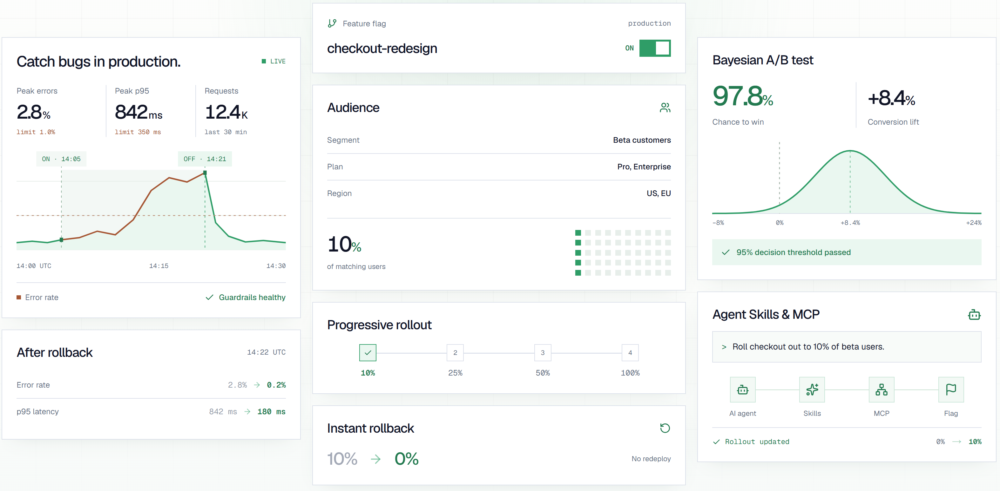

<div align="center">
  <picture>
    <source media="(prefers-color-scheme: dark)" srcset="modules/front-end/public/assets/featbit-logo-dark.svg">
    <source media="(prefers-color-scheme: light)" srcset="modules/front-end/public/assets/featbit-logo.svg">
    
  </picture>
  <h1>FeatBit</h1>
</div>

## About FeatBit

AI helps teams ship more code and features faster. More changes also mean more opportunities for bugs and poor business decisions to affect users. Observing each feature release and limiting its blast radius matters more than ever.

FeatBit is an open-source feature flag platform that helps you manage that risk. Roll out features gradually, observe their technical and business impact, and turn them off without redeploying when something goes wrong.

Visit [www.featbit.co](https://www.featbit.co).



## Get started in 3 steps

Prefer a hosted service? [Use FeatBit Cloud](https://app.featbit.co) without managing infrastructure.

To self-host, you'll need Git and Docker with Docker Compose.

### 1. Start FeatBit

```bash
git clone --branch 6.0.0 --depth 1 https://github.com/featbit/featbit.git
cd featbit
docker compose up -d
```

Once the containers have started, open [http://localhost:8081](http://localhost:8081) and sign in with the default credentials:

- Username: **test@featbit.com**
- Password: **123456**

### 2. Connect an SDK

Choose an [official SDK](https://docs.featbit.co/sdk/overview) for your application. Follow the portal's getting-started guide to initialize it with your environment's SDK key and connection URLs.

### 3. Check a feature flag

Create a boolean flag named `user-new-algorithm` in the same environment and set its off variation to `false`. After initializing the .NET SDK, evaluate the flag in your code:

```csharp
var user = FbUser.Builder("tester-id").Name("tester").Build();
if (featbit.BoolVariation("user-new-algorithm", user, false))
{
    // Run the new algorithm.
}
else
{
    // Run the existing algorithm.
}
```

Use the portal to release the feature to a small group of users, observe the results, and expand the rollout. Turn the flag off to return to the existing behavior.

## Configure and run FeatBit anywhere

Run FeatBit on your own infrastructure, on premises or in the cloud. Choose the setup that fits your environment:

- **Kubernetes**: deploy with the official [Helm charts](https://github.com/featbit/featbit-charts) or the [manifest files](kubernetes).
- **AWS**: deploy with [FeatBit's Terraform project](https://github.com/featbit/featbit-terraform-aws).
- **Azure Container Apps**: deploy with [FeatBit's Terraform project](https://github.com/featbit/azure-container-apps).
- **Microsoft Aspire**: deploy to Azure Container Apps with [FeatBit Aspire](https://github.com/featbit/featbit-aspire).
- **Docker Compose**: follow the [self-hosting guide](https://docs.featbit.co/installation/docker-compose) to run FeatBit and its dependencies.

## Contribute

Contributions to code, SDKs, documentation, and bug reports are welcome. Read the [contributing guide](CONTRIBUTING.md) to get started, browse [open issues](https://github.com/featbit/featbit/issues), or join the community on [Discord](https://discord.gg/h9dVMsQH).

## License

FeatBit is an Open Core product. Most of its code is available under the [MIT license](LICENSE).

Certain features require a valid license key. See the [license documentation](https://docs.featbit.co/licenses/overview) for details.
