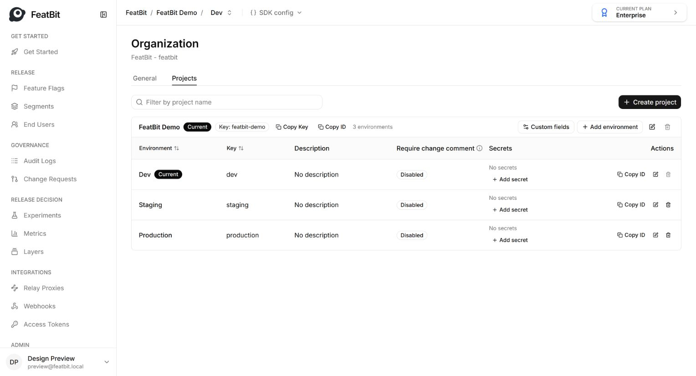
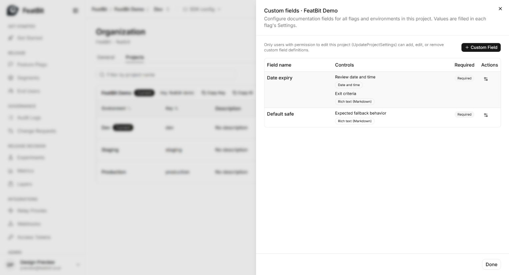
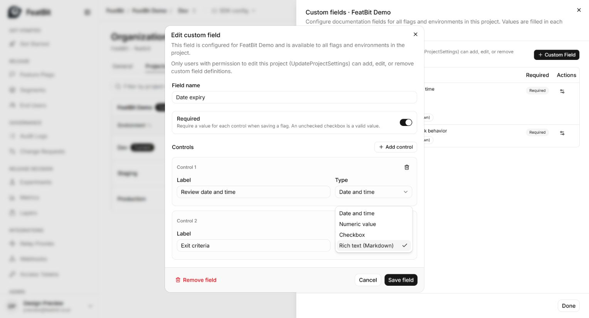
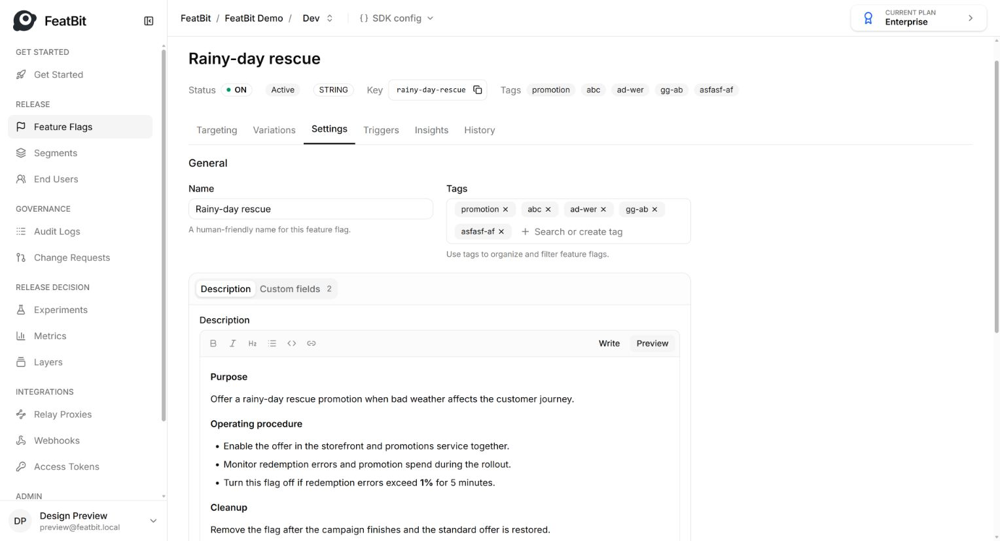
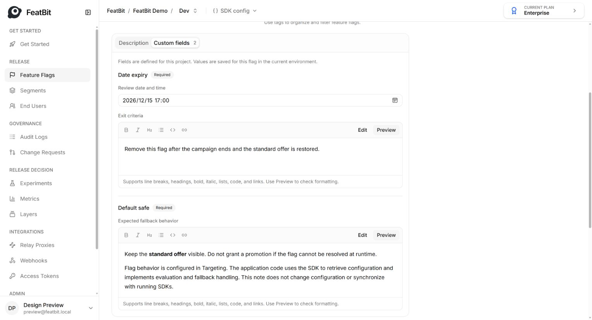
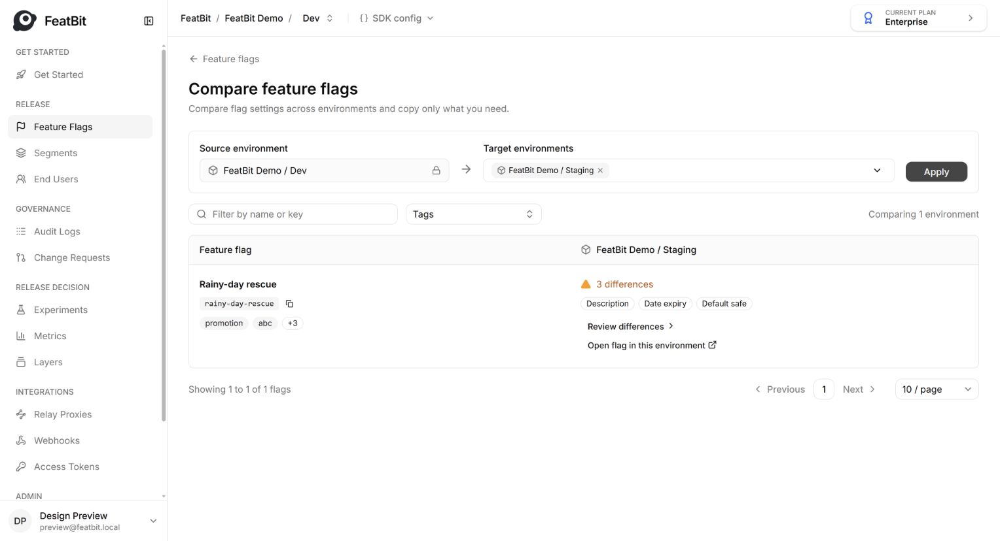
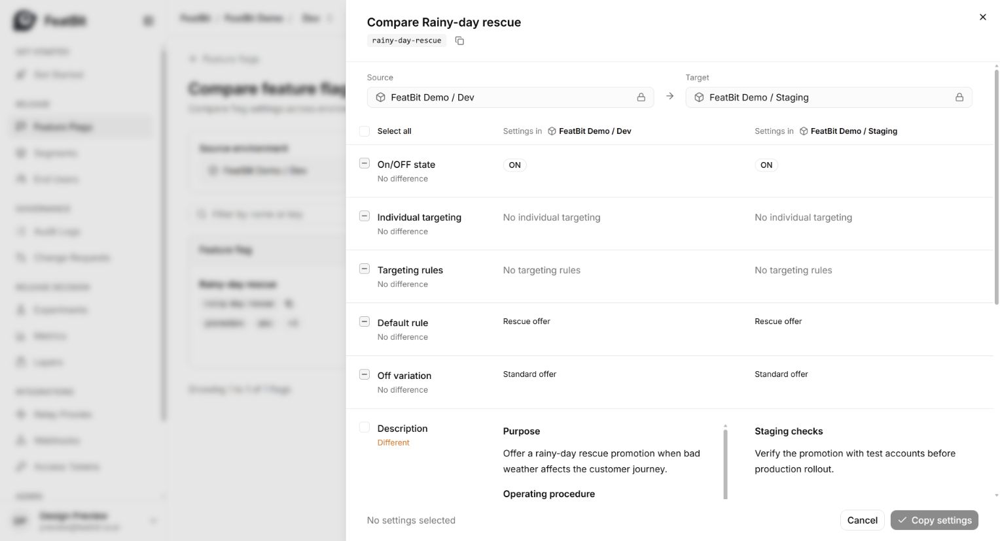
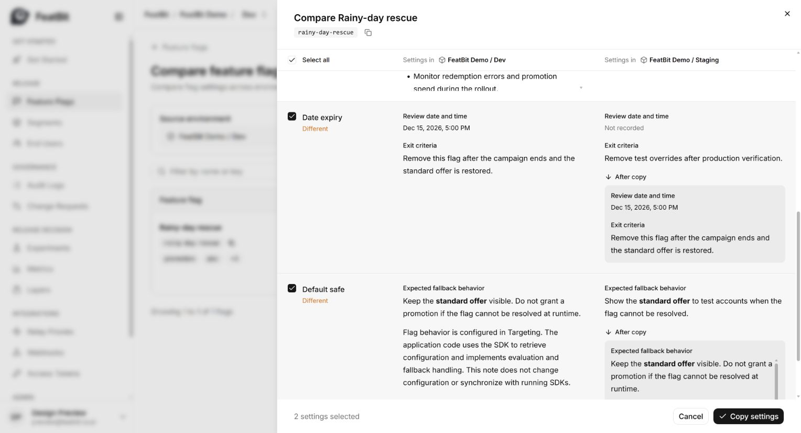

# Feature Flag Documentation & Custom Fields

Define documentation fields once per project, then fill in their values for each flag and environment.

## 1. Configure fields for the project

**Only users with permission to edit the current project (`UpdateProjectSettings`) can add, edit, or remove field definitions.**

1. Open **Organization → Projects**.
2. Find the project and select **Custom fields**.

3. Select **+ Custom Field** to create a field, or the settings icon beside an existing field to edit it.

4. Enter a **Field name** and choose whether it is **Required**.
5. Select **Add control**, enter its label, and choose **Date and time**, **Numeric value**, **Checkbox**, or **Rich text (Markdown)**. One field can contain multiple controls.
6. Select **Save field**.

Definitions apply to all flags and environments in this project. Required controls must be completed when saving a flag. Other projects use their own definitions.

## 2. Write the flag's description

1. Select the project and environment, open the flag, and select **Settings → Description**.
2. Use **Write** to edit and **Preview** to check the formatted text. Headings, lists, emphasis, links, code, and line breaks make operating procedures easier to read.
3. Select **Review & save**, review the changes, and save them.

## 3. Fill in the custom fields

1. In the same Settings page, select **Custom fields**.
2. Fill in the controls configured for this project. Markdown controls open in **Preview**; select **Edit** to change the text.
3. Select **Review & save**, review the changes, and save them.

The example uses **Date expiry** for a review date/time and exit criteria, and **Default safe** for expected fallback behavior. Names and control combinations are configurable. Flag editors fill in values here; they do not change field definitions.

- **Expiry is a record:** it does not automatically turn the flag off.
- **Default safe is documentation:** flag behavior is configured in **Targeting**. The application retrieves configuration through the SDK and implements fallback handling in its code. This text does not change configuration or synchronize with running SDKs.

Field definitions are shared across the project. **Description and custom field values are saved separately for each flag and environment.**

### Applications and “sub-projects”: preferred Tags approach

Use existing **Tags** to identify applications within a project. A shared flag can carry multiple application tags, such as `app:web-storefront` and `app:promotions-api`, without duplicating the flag across projects.

To keep labels consistent and reduce unauthorized changes, **tag creation should be restricted through permissions to designated users, such as PMs**. Changes to the tags assigned to a flag should also be limited to authorized users. Tags provide application labels and filtering within the existing project; they do not introduce a separate sub-project hierarchy.

## 4. Compare and copy between environments

1. Open **Feature Flags → Compare**.
2. Select the target environment and choose **Apply**. The current environment is the source.
3. Select **Review differences** for the flag.

4. Review the source and target values. Each setting is marked **Different** or **No difference**; matching settings cannot be selected for copying.

5. Select **Description** and/or the custom fields to copy. Check the **After copy** preview and selected setting count.
6. Select **Copy settings** to overwrite those values in the target environment.

Only saved values are compared and copied. Each custom field copies all of its controls together. Unselected settings and project field definitions are preserved. Copying documentation follows the existing copy permissions and requires **Update flag description (`UpdateFlagDescription`)** permission on the target flag.

## 5. Audit and automation

All operations must have **audit logs** and **REST API support**, with the same permissions and validation as the interface, so teams can automate workflows or use AI agents. Changes must record the actor, time, scope, and before/after values.
